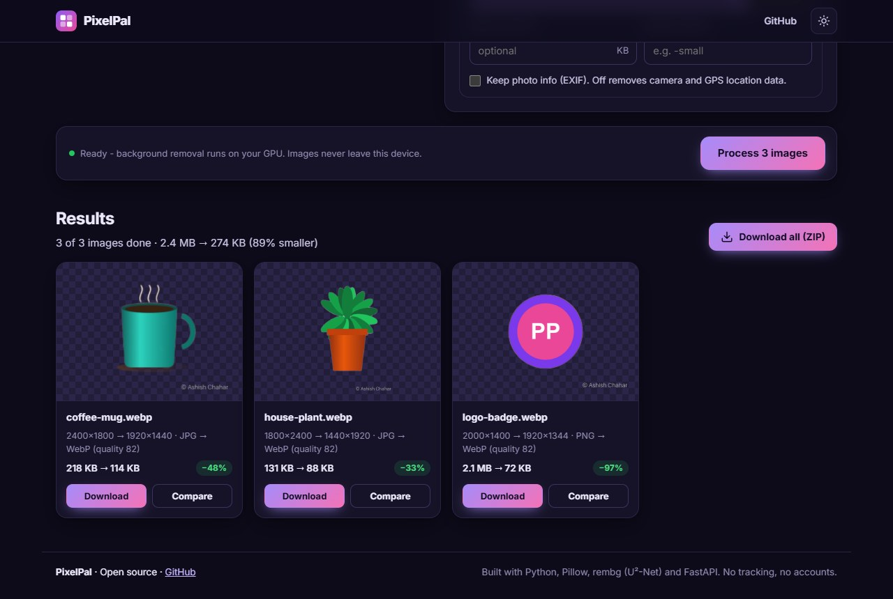
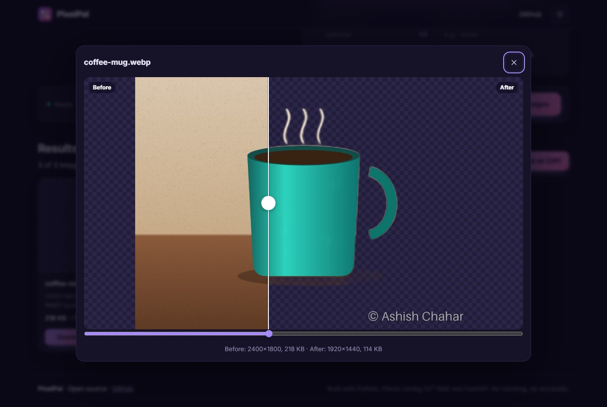
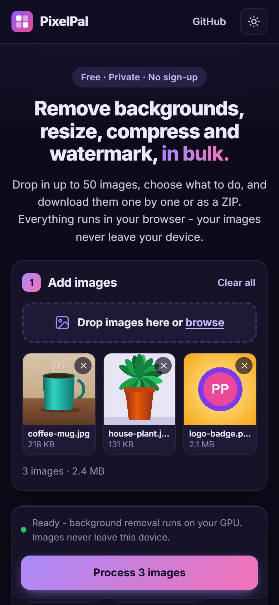

# 🖼️ PixelPal

**Remove backgrounds, resize, compress, convert and watermark images, in bulk.**

Drop in up to 50 images (PNG, JPG, WebP, GIF, BMP or TIFF), choose what to do, and
download the results one by one or as a ZIP. Built with Python: Pillow for image
processing, rembg's U²-Net model for AI background removal, and FastAPI for the API.

Free, private and no sign-up.

### 🔗 Live demo: **[insofury.github.io/pixelpal](https://insofury.github.io/pixelpal/)**

The live demo runs **100% in your browser**: the Python code runs on
[Pyodide](https://pyodide.org) (Python compiled to WebAssembly) and the AI model runs on
[onnxruntime-web](https://onnxruntime.ai) (on your GPU when the browser supports WebGPU).
Your images never leave your device.

[](https://github.com/Insofury/pixelpal/actions/workflows/ci.yml)
[](https://github.com/Insofury/pixelpal/actions/workflows/pages.yml)



<table>
  <tr>
    <td width="66%"></td>
    <td></td>
  </tr>
</table>

## Features

| | |
|---|---|
| ✨ **AI background removal** | U²-Net cuts out the main subject. Keep it transparent or put it on white or any colour. |
| 📐 **Resize** | *Fit inside* a box (keeps the shape), *crop to an exact size* (centred) or *scale by %*. Never enlarges unless you ask. |
| 🗜️ **Compress** | Quality slider, or **"max file size"**: PixelPal finds the highest quality that fits (binary search). Lossy PNG with a 256-colour palette. |
| 🔁 **Convert** | PNG ⇄ JPG ⇄ WebP (GIF, BMP and TIFF in). Transparency is handled for you. |
| ©️ **Watermark** | Text in any of 9 positions or tiled diagonally, with opacity, size and colour. A thin outline keeps it readable on any photo. |
| 📦 **Bulk + ZIP** | Up to 50 images per batch with progress, per-image savings and a one-click ZIP. |
| 🔍 **Before / after** | Drag a slider to compare the original and the result. |
| ⚡ **Presets** | Web-ready, Product photo, Profile picture, Instagram square, Under 200 KB. |
| 🛡️ **Privacy** | Removes EXIF (camera and GPS) by default, fixes phone rotation, keeps colour profiles. |
| 🌗 **Polished UI** | Dark/light themes, drag-and-drop, paste with Ctrl+V, mobile-friendly, accessible. |

## Two ways to run it

| | Browser version (GitHub Pages) | Server version (FastAPI) |
|---|---|---|
| Where | [insofury.github.io/pixelpal](https://insofury.github.io/pixelpal/) | `python run.py`, Docker, Render… |
| Image processing | Pyodide runs `app/pipeline.py` in a Web Worker | The API runs `app/pipeline.py` |
| Background removal | u2netp with onnxruntime-web (WebGPU or WebAssembly) | rembg (any of its models) with onnxruntime |
| Privacy | Images never leave the device | Processed in memory, never stored |
| Speed | Good; best with WebGPU | Fastest, especially for big batches |

Both use **the same Python code** for everything except running the model. The UI picks
the engine automatically: the Pages build includes a `browser-mode.json` file, the server
doesn't.

## Quick start (server version)

Requires **Python 3.11+**.

```bash
git clone https://github.com/Insofury/pixelpal.git
cd pixelpal
python -m venv .venv
```

```bash
# Windows
.venv\Scripts\activate
# macOS / Linux
source .venv/bin/activate
```

```bash
pip install -r requirements.txt
python run.py
```

Open **http://localhost:8000**. The first background removal downloads the u2netp model
(4.5 MB) into `~/.u2net`. Settings (limits, model, rate limits) are in
[`.env.example`](.env.example).

## Deploy (free)

**GitHub Pages (browser version):** every push to `main` runs
[`.github/workflows/pages.yml`](.github/workflows/pages.yml), which builds the static site
with `scripts/build_pages.py` and publishes it. To preview the build locally:

```bash
python scripts/build_pages.py
python -m http.server -d _site 8040
```

**Docker (server version, anywhere):** the image includes the model, so the first request
is fast.

```bash
docker build -t pixelpal .
docker run -p 8000:8000 -e TRUST_PROXY=true pixelpal
```

**Render:** [`render.yaml`](render.yaml) deploys the Docker image on the free plan.

## API

Interactive docs at **`/api/docs`**.

```bash
curl -F "file=@photo.jpg" \
     -F 'options={"remove_background": true, "resize": "fit", "width": 1200, "format": "webp"}' \
     -o photo.webp http://localhost:8000/api/process
```

| Method | Path | Description |
|---|---|---|
| `POST` | `/api/process` | Form fields `file` + `options` (JSON) → the processed image. Details (sizes, dimensions, notes) are in the `X-PixelPal-Info` header. |
| `GET` | `/api/config` | Limits and whether background removal is available |
| `GET` | `/api/health` | Health check |

**Options** (all optional):

| Key | Values | Default |
|---|---|---|
| `remove_background` | `true` / `false` | `false` |
| `background` | `""` (transparent) or `"#rrggbb"` | `""` |
| `resize` | `none`, `fit`, `cover`, `percent` | `none` |
| `width`, `height` | pixels (0 = any, for `fit`) | `0` |
| `percent` | 1–1000 | `100` |
| `upscale` | let `fit` enlarge small images | `false` |
| `format` | `original`, `jpeg`, `png`, `webp` | `original` |
| `quality` | 1–100 (JPG / WebP) | `82` |
| `target_kb` | max file size in KB (JPG / WebP) | `0` (off) |
| `png_colors` | 256-colour palette PNG | `false` |
| `keep_metadata` | keep EXIF | `false` |
| `suffix` | added to the file name, e.g. `-web` | `""` |
| `watermark` | `{text, position, opacity, size, color}`; position is one of 9 spots or `tile` | no watermark |

## Project structure

```
pixelpal/
├── app/
│   ├── main.py         FastAPI routes + static site
│   ├── pipeline.py     decode -> background -> resize -> watermark -> encode (shared)
│   ├── options.py      the options and their validation
│   ├── imaging.py      Pillow: reading, resizing, converting, compressing
│   ├── background.py   U²-Net background removal (rembg on the server, maths for the browser)
│   ├── watermark.py    text watermarks (corner, edge, centre or tiled)
│   ├── browser.py      entry point for the Pyodide / GitHub Pages build
│   ├── security.py     rate limiting, security headers, upload size limit
│   └── config.py       settings from environment variables
├── static/             HTML, CSS and vanilla JS (engine.js picks server or browser mode,
│                       worker.js runs Python + the model off the main thread, zip.js)
├── scripts/build_pages.py   builds the GitHub Pages site into _site/
├── tests/              65 pytest tests
└── docs/PROJECT_NOTES.md    full module-by-module guide
```

📘 See **[docs/PROJECT_NOTES.md](docs/PROJECT_NOTES.md)** for how everything works, module
by module.

## Tests

```bash
pip install -r requirements-dev.txt
pytest -q
```

Two tests also check that the browser's background-removal maths matches rembg, and that
the WebGPU-compatible model gives identical output. They run when the u2netp model is
present in `~/.u2net`.

## Privacy

In the **browser version** your images never leave your device. In the **server
version** uploads are processed in memory and discarded; nothing is written to disk or
logged. Photo metadata (EXIF, including GPS location) is removed unless you choose to keep
it.

## Credits

- [U²-Net](https://github.com/xuebinqin/U-2-Net) by Xuebin Qin et al. (Apache-2.0): the
  background-removal model (u2netp).
- [rembg](https://github.com/danielgatis/rembg) by Daniel Gatis (MIT).
- [Pillow](https://python-pillow.org), [NumPy](https://numpy.org),
  [Pyodide](https://pyodide.org), [onnxruntime](https://onnxruntime.ai) and
  [FastAPI](https://fastapi.tiangolo.com).

## License

MIT - see [LICENSE](LICENSE).
