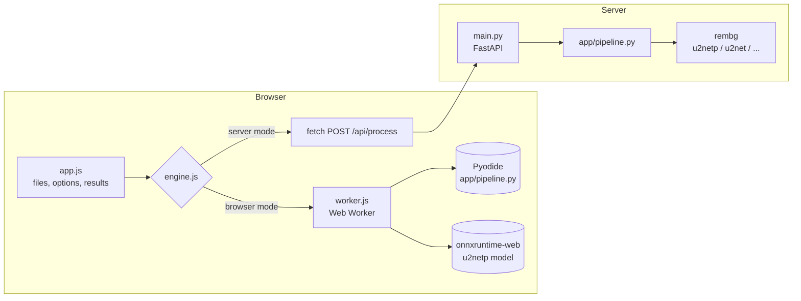

# PixelPal - Project Notes & Code Guide

A complete guide to how PixelPal works: what each module contains, how the pieces fit
together, and the reasoning behind the main decisions. Read it top to bottom once, then
use it as a reference.

---

## 1. Summary

**PixelPal** is a bulk image toolkit. A user drops in up to 50 images, picks what to do,
and downloads the results one by one or as a ZIP. It can:

| Tool | What it does |
|---|---|
| **Remove background** | An AI model (U²-Net) finds the main subject; everything else becomes transparent, white or any colour. |
| **Resize** | *Fit inside* a box keeping the shape, *crop to size* (fill the box, trim the overflow, centred) or *scale by %*. |
| **Compress** | JPG/WebP quality, or a **max file size** target (binary search over quality); lossy PNG via a 256-colour palette. |
| **Convert** | PNG, JPG and WebP out; PNG, JPG, WebP, GIF, BMP and TIFF in. |
| **Watermark** | Text in 9 positions or tiled diagonally; opacity, size and colour; automatic contrasting outline. |
| **Privacy** | EXIF (camera model, GPS) removed by default; phone rotation applied; colour profiles kept. |

**Tech stack:** Python 3.11+, Pillow, NumPy, rembg (U²-Net via onnxruntime), FastAPI and
Uvicorn on the server; vanilla HTML/CSS/JavaScript (no framework, no build step) in the
browser; Pyodide and onnxruntime-web for the GitHub Pages version; pytest; GitHub Actions.

### Two versions, one codebase

| | Server version | Browser version (GitHub Pages) |
|---|---|---|
| Runs | FastAPI on any Python host | Static files on GitHub Pages |
| Image pipeline | `app/pipeline.py` in CPython | the **same file** in Pyodide (WebAssembly) |
| Background model | rembg → onnxruntime (any rembg model) | u2netp → onnxruntime-web (WebGPU or WebAssembly) |
| Images | uploaded, processed in memory, discarded | never leave the device |

`static/js/engine.js` hides the difference from the UI: both engines expose the same
`process(file, options)` method. The UI checks for `browser-mode.json` (only present in the
Pages build) to decide which engine to use.

---

## 2. Architecture



### The pipeline (`pipeline.process`)

```
bytes ──► load_image ──► remove background? ──► resize? ──► watermark? ──► encode ──► Result
          (decode,         (mask from model,      (fit /       (text tile,     (format, quality /
           rotate,          multiply into         cover /       alpha           size target,
           normalise        alpha, optional       percent)      composite)      metadata)
           mode)            colour fill)
```

Every step is a pure function of the image and the `Options`, which makes the pipeline
easy to test and lets it run unchanged in Pyodide.

---

## 3. Folder structure

```
pixelpal/
├── app/                       Python package
│   ├── __init__.py            version
│   ├── options.py             Options / Watermark dataclasses + validation
│   ├── imaging.py             decode, normalise, resize, encode, compress (Pillow)
│   ├── background.py          U²-Net pre/post-processing + RembgRemover (server)
│   ├── watermark.py           text watermarks
│   ├── pipeline.py            the processing pipeline + Result
│   ├── browser.py             Pyodide entry point (GitHub Pages)
│   ├── config.py              Settings from environment variables / .env
│   ├── security.py            rate limiter, body-size limit, security headers
│   └── main.py                FastAPI app: API routes + static site
├── static/
│   ├── index.html             the single page
│   ├── favicon.svg            logo
│   ├── css/styles.css         design tokens, light/dark themes, components
│   └── js/
│       ├── theme.js           applies the saved theme before first paint
│       ├── app.js             UI controller
│       ├── engine.js          ServerEngine / BrowserEngine
│       ├── worker.js          Web Worker: Pyodide + onnxruntime-web
│       └── zip.js             tiny ZIP writer (no dependencies)
├── scripts/build_pages.py     builds the GitHub Pages site into _site/
├── tests/                     pytest suite (65 tests)
├── docs/                      these notes + README screenshots
├── .github/workflows/         ci.yml (tests) and pages.yml (deploy)
├── Dockerfile, render.yaml, Procfile, run.py
├── requirements.txt, requirements-dev.txt, .env.example
└── README.md, LICENSE
```

---

## 4. Backend modules

### 4.1 `app/options.py` - what to do to each image

- **`Watermark`** (frozen dataclass): `text`, `position` (one of 9 spots or `tile`),
  `opacity` (0.05–1), `size` (text height as % of the image's shorter side), `color`.
  `enabled` is true when there is text.
- **`Options`** (frozen dataclass): `remove_background`, `background`, `resize`, `width`,
  `height`, `percent`, `upscale`, `format`, `quality`, `target_kb`, `png_colors`,
  `keep_metadata`, `suffix`, `watermark`.
- **`Options.from_json` / `from_dict`** validate everything and raise **`OptionsError`** with
  a message written for users ("Enter a width or a height to resize to."). Helpers:
  `_bool`, `_choice` (with aliases such as `jpg` → `jpeg`), `_number` (range checks, NaN
  rejected), `_color` (`#rrggbb`), `_text` (collapses whitespace, length limit).
- The suffix is stripped to `[A-Za-z0-9._-]`, so file names can't contain paths.

### 4.2 `app/imaging.py` - Pillow work

- **`load_image(data, max_pixels)`** → `Loaded` (image + original format, size, bytes, ICC
  profile, EXIF). Steps:
  1. `Image.open` on the bytes (nothing touches the disk). Unknown data → `ImageError`.
  2. The format must be one of `INPUT_FORMATS`; MPO (how Pillow reports many camera JPEGs)
     counts as JPEG.
  3. **Pixel limit check before decoding** (`width × height`): protects against
     "decompression bombs" (tiny files that expand to gigabytes). Pillow's own check is
     turned off in favour of this friendlier message (HTTP 413).
  4. `img.load()` decodes; truncated or corrupt files fail here → "looks damaged".
  5. `ImageOps.exif_transpose` applies the phone's rotation flag, so portrait photos stay
     upright after the metadata is removed.
  6. `_normalise_mode` converts everything to RGB or RGBA: palette images (keeping
     transparency), greyscale, 16-bit greyscale (rescaled to 8-bit), CMYK. When the
     conversion changes the colour space the ICC profile is dropped (a CMYK profile on RGB
     pixels would show wrong colours).
- **`has_alpha`**: true only if some pixel is actually transparent (an RGBA PNG that is fully
  opaque can still become a JPG without notes).
- **`flatten(img, color)`**: places a transparent image on a solid colour.
- **`target_size` / `resize`**:
  - `fit`: scale = min(width ratio, height ratio), capped at 1 unless `upscale`. A missing
    width or height means "no limit on that side".
  - `cover`: `ImageOps.fit` scales to cover the box and crops the overflow equally (centred).
  - `percent`: both sides × percent / 100.
  - The output size is checked against the pixel limit too (1000% of a big photo would
    otherwise explode).
  - LANCZOS gives the sharpest downscale; `reducing_gap=3.0` makes big downscales several
    times faster (Pillow first shrinks by an integer factor with a box filter). Pillow
    premultiplies alpha while resizing, so cut-out edges don't get dark fringes.
- **`choose_format`**: `original` keeps PNG/JPG/WebP and turns GIF/BMP/TIFF into PNG. If the
  source was JPG but the result is transparent (background removed), it switches to PNG and
  adds a note.
- **`save`** encodes once:
  - JPEG: `optimize=True, progressive=True` (≈10–15% smaller, loads progressively).
  - WebP: `method=2` - measured 2–3× faster than the default `method=4` for about the same
    size.
  - PNG: `optimize=True` only up to 2.5 MP; bigger images use zlib level 6 (optimising a
    big image takes seconds for a few % saving). `png_colors=True` quantises to 256 colours
    with Floyd-Steinberg dithering (FASTOCTREE, which also keeps alpha).
  - The ICC profile is passed through; EXIF only when the user keeps metadata.
- **`encode`** - compression logic:
  - JPG can't store transparency: transparent areas are filled (with the chosen background
    colour or white) and a note says so.
  - **Size target**: encode at the chosen quality; if it's too big, **binary-search** the
    quality between 5 and the chosen value for the highest quality that fits (about 6
    encodes for 1–100). If even quality 5 doesn't fit, return that and suggest resizing.
- **`exif_bytes`**: when metadata is kept, writes EXIF back with the orientation reset to
  "normal" (the pixels were already rotated).

### 4.3 `app/background.py` - AI background removal

**How U²-Net works (short version):** it is a neural network trained for *salient object
detection*: "which pixels belong to the main subject?". It looks at a 320×320 copy of the
photo and outputs a 320×320 map of values; higher means "subject". We scale that map back
to the photo's size and use it as the **alpha channel** (0 = transparent, 255 = opaque),
which gives soft, natural edges. `u2netp` is the small 4.5 MB version; rembg also offers
larger, more accurate models.

- **`prepare_input(img)`** → float32 tensor `(1, 3, 320, 320)`: resize to 320×320, divide by
  the max value, subtract the ImageNet mean and divide by the standard deviation per
  channel, then reorder to channels-first. This mirrors rembg's code for u2netp exactly.
- **`mask_from_output(prediction, size)`**: min-max scale the model output to 0–1, convert
  to an 8-bit greyscale image and resize it to the photo (LANCZOS).
- **`apply_mask(img, mask, background)`**: multiplies the mask into the existing alpha
  (so already-transparent pixels stay transparent), then optionally flattens onto a colour.
- **`RembgRemover`** (server only): imports rembg lazily, creates one session per process
  under a lock (the first call downloads the model), and `mask(img)` returns rembg's mask.
  `warm_up()` is called in a background thread at startup (`PRELOAD_MODEL`) because rembg's
  first import compiles some numba code.
- A test checks that our browser maths matches rembg on the same photo (mean difference
  under 2/255).

### 4.4 `app/watermark.py`

- **Font:** `ImageFont.load_default(size=...)` - Pillow ≥ 10.1 ships a scalable font, so
  there is no font file to bundle (it also works in Pyodide). If Pillow was built without
  FreeType, it falls back to the bitmap font and scales the rendered text up.
- **`render_text`** draws the text on a transparent tile with a thin outline in the
  opposite brightness (black outline for light text and vice versa), so it's readable on
  any photo.
- **`add_watermark`**:
  - text height = `size`% of the shorter side;
  - corner/edge/centre: 3% margin; text longer than the image is shrunk to fit;
  - `tile`: the tile is rotated 30° and repeated in a brick pattern (every other row
    shifted by half a step);
  - the text is drawn on its own layer and combined with `Image.alpha_composite`, so opacity
    is exact.
- The pipeline converts the result back to RGB when the photo had no transparency, so a
  watermark never adds a useless alpha channel.

### 4.5 `app/pipeline.py` - the pipeline

- **`process(data, filename, options, mask_fn=None, max_pixels=...)`** → `Result`.
  `process_loaded` does the work on an already-decoded image (the browser decodes once and
  reuses it for both the model input and the final result).
- **`mask_fn`** is how background removal is plugged in: the server passes
  `RembgRemover.mask`; the browser passes a function that turns the onnxruntime-web output
  into a mask; tests pass a fake. Without one, asking for background removal gives a clear
  503 error.
- **`Result`**: `data`, `filename`, `format`, `mime`, `width`, `height`, `quality`,
  `original` (width, height, bytes, format) and `notes`. `info()` returns everything except
  the bytes, plus `bytes` and `saved_percent` - what the UI shows.
- **`output_name`**: keeps the original name, drops any path, replaces characters that are
  invalid in file names, adds the suffix and the new extension.

### 4.6 `app/browser.py` - Pyodide entry point

Files move through Pyodide's **in-memory file system** (fast, and nothing leaves the
browser):

1. JS writes the picked file to `/tmp/src-N`.
2. For background removal, **`prepare_background(src, tensor_path)`** decodes the image
   (cached in `_decoded`), writes the model input tensor; JS runs the model and writes the
   output to `/tmp/mask-N`.
3. **`process_file(src, filename, options_json, out_path, mask_path)`** runs the pipeline and
   writes the result; JS reads it back as a Blob.

Both return JSON (`{"ok": true, ...}` or `{"ok": false, "error": "..."}`) and always delete
the temporary files.

### 4.7 `app/main.py`, `app/security.py`, `app/config.py`

- **`create_app(settings, remover)`** builds the FastAPI app (the factory makes testing easy:
  tests inject settings and a fake remover).
- **`POST /api/process`**: rate-limits per IP; parses options; checks background removal is
  available; reads at most `MAX_UPLOAD_MB + 1` bytes; runs the pipeline in a worker thread
  (`run_in_threadpool`, image work is CPU-bound and must not block the event loop);
  background removals also take a slot from a semaphore (`BG_CONCURRENCY`) so a burst can't
  exhaust memory. The response is the image itself; details go in the `X-PixelPal-Info`
  header (ASCII-safe JSON) and the file name in an RFC 6266 `Content-Disposition` that
  supports non-English names.
- **Errors**: `ImageError` / `OptionsError` → 400, too big → 413, no model → 503, rate
  limit → 429 with `Retry-After`.
- **`security.py`**:
  - `RateLimiter`: sliding window per key, with bounded memory.
  - `BodySizeLimitMiddleware`: rejects oversized uploads from `Content-Length` before
    reading them.
  - `SecurityHeadersMiddleware`: a strict Content-Security-Policy (`img-src` allows `blob:`
    for previews) plus `nosniff`, `DENY` framing, a referrer policy and a permissions policy.
  - `client_ip`: honours `X-Forwarded-For` only when `TRUST_PROXY` is on.
- **`config.py`**: a frozen `Settings` dataclass read from environment variables (and a
  minimal `.env` loader). See `.env.example`.

---

## 5. Frontend

- **No framework, no build step**: ES modules served as-is.
- **`app.js`** (UI controller):
  - *Files*: drag-and-drop anywhere, file picker, paste (Ctrl+V); type, size and 50-file
    limits with a summary toast; thumbnails from `URL.createObjectURL` (TIFF shows its
    extension, since browsers can't display it).
  - *Options*: `readOptions()` builds the same JSON the API expects; `validate()` catches
    common mistakes before any work starts; `syncUI()` shows/hides dependent controls;
    presets reset the form and apply their values; options are remembered in
    `localStorage`.
  - *Processing*: images go one at a time with a progress bar; each result card updates
    live (waiting → processing → done or failed); one failing image doesn't stop the batch.
  - *Results*: preview on a checkerboard (to show transparency), dimensions, format,
    before → after size with % saved, notes, Download and Compare.
  - *Compare dialog*: a native `<dialog>`; both images are stacked and each is clipped to
    its side of the slider with `clip-path`, so the original never shows through the
    transparent parts of the result. Drag on the image or use the range input (keyboard
    accessible).
  - *ZIP*: `zip.js`.
- **`engine.js`**: `ServerEngine` (multipart upload to `/api/process`, reads the info header)
  and `BrowserEngine` (talks to the worker with request ids; transfers `ArrayBuffer`s
  instead of copying them).
- **`worker.js`** (browser version, a Web Worker so the page never freezes):
  - loads Pyodide, Pillow and NumPy, then fetches the PixelPal modules into Pyodide's file
    system;
  - loads onnxruntime-web only when background removal is first needed. If the browser has
    **WebGPU**, it loads the WebGPU build and runs the model on the GPU (with a warm-up run
    to compile the shaders); otherwise it uses WebAssembly on the CPU. If the GPU fails
    mid-way, it switches to the CPU and retries;
  - processes one job at a time, in order;
  - reports progress messages that the page shows in the status line.
- **`zip.js`**: writes a standard ZIP (local headers, central directory, CRC-32, UTF-8
  names) without compression, since images are already compressed. Duplicate names get
  " (2)".
- **CSS**: design tokens on `:root`, a dark theme via `prefers-color-scheme` or
  `[data-theme]`, a responsive two-column layout that becomes one column on phones, a
  sticky action bar, and `prefers-reduced-motion` support.

---

## 6. API reference

### `POST /api/process` (multipart form)

| Field | Type | Notes |
|---|---|---|
| `file` | file | PNG, JPG, WebP, GIF, BMP or TIFF, up to `MAX_UPLOAD_MB` |
| `options` | string | JSON, see the README's options table |

Returns the image (`image/png`, `image/jpeg` or `image/webp`). Header `X-PixelPal-Info`:

```json
{"filename": "photo.webp", "format": "webp", "mime": "image/webp", "width": 1200,
 "height": 800, "bytes": 84213, "quality": 82, "saved_percent": 71.4,
 "original": {"width": 2400, "height": 1600, "bytes": 294511, "format": "jpeg"},
 "notes": []}
```

### `GET /api/config`

`{"version", "mode": "server", "background_removal", "bg_model", "max_upload_mb",
"max_megapixels", "formats", "file_types"}`

---

## 7. GitHub Pages build (`scripts/build_pages.py`)

1. Copies `static/` and `index.html` (all asset paths are relative, so the site works under
   `/pixelpal/`).
2. Copies the 7 browser modules to `_site/py/app/`. A test makes sure they only import the
   standard library, Pillow and NumPy - never FastAPI or rembg.
3. Downloads `u2netp.onnx` from rembg's releases (or reuses a copy rembg already downloaded), **verifies its
   SHA-256**, and patches it for WebGPU:
   - The model's 33 MaxPool layers use `ceil_mode=1`, which onnxruntime-web's WebGPU
     backend can't run. With a 320×320 input every pooled size is even (320 → 160 → … →
     10), so floor and ceil give identical results.
   - The build flips one byte per layer (same file length) and verifies the patched file's
     SHA-256 too. A test confirms the outputs are bit-for-bit identical.
4. Writes `browser-mode.json` (Pyodide and onnxruntime-web versions and URLs, the module
   list, the model, browser limits) and `.nojekyll`.

`.github/workflows/pages.yml` runs this on every push to `main` and deploys `_site`.

---

## 8. Testing

```bash
pip install -r requirements-dev.txt
pytest -q          # 65 tests
```

| File | Covers |
|---|---|
| `test_options.py` | defaults, parsing, aliases, every validation error |
| `test_imaging.py` | bad / truncated / huge files, EXIF rotation, colour modes, GIF frames, resize modes, formats, size targets, PNG palette, JPG flattening, metadata stripping, file names |
| `test_background_watermark.py` | model input/output maths, alpha handling, pipeline with a fake mask, **parity with rembg**, **patched model = original**, watermark placement / tiling / shrinking |
| `test_api.py` | config, processing, headers, Unicode file names, background removal on/off, 400/413/422/429/503 errors, CSP, static site |
| `test_pages.py` | the Pyodide entry point (including the background flow), error messages, build output, model patch checks, browser import guard |

Tests make images in memory (`tests/helpers.py`), so there are no fixture files.

---

## 9. Design decisions

- **Same Python code in both versions** - one pipeline to test and maintain, and the live
  demo is free (static hosting) and private (no uploads).
- **Web Worker** - Python and the model run off the main thread, so progress updates and
  scrolling stay smooth during a 50-image batch.
- **One image at a time** - predictable memory use (big photos are expanded to several
  hundred MB in memory) and live per-image results.
- **u2netp** - 4.5 MB loads quickly in a browser; the server can switch to larger rembg
  models with `BG_MODEL`.
- **Size target by binary search** - more predictable than guessing quality, and never goes
  above the quality the user chose.
- **Metadata off by default** - photos often carry GPS location; removing it is the safe
  default.
- **Measured defaults** - WebP `method=2` and PNG `optimize` only on smaller images came
  from timing real encodes (see section 4.2).

---

## 10. How to extend

- **New tool** (e.g. rotate, crop, filters): add fields to `Options` (+ validation), a step in
  `pipeline.process_loaded`, a control in `index.html`, and read it in `readOptions()`.
  Both versions get it automatically.
- **Image watermark (logo)**: add an optional second upload, then `alpha_composite` it like
  the text tile.
- **Better cut-outs**: set `BG_MODEL=isnet-general-use` or `birefnet-general` on the server.
- **HEIC (iPhone) input**: `pillow-heif` on the server (not available in Pyodide).
- **Parallel server batches**: send 2–3 requests at a time from `app.js` (the server already
  limits concurrent background removals).
